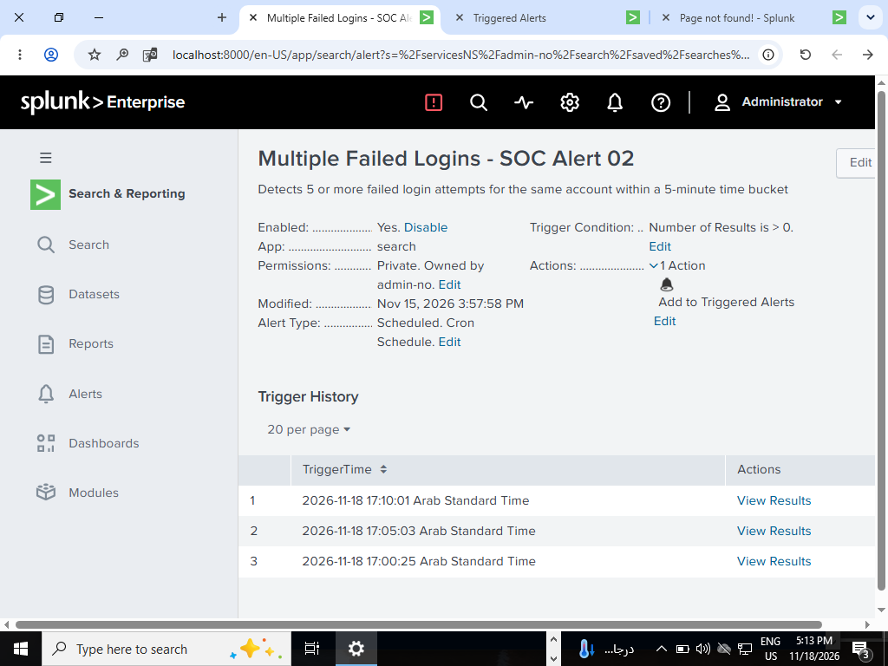

Windows Failed Login Detection & Automated Alerting Using Splunk 
# Project Overview 
This project demonstrates how to detect multiple failed Windows login attempts using Splunk Enterprise and configure an automated SOC security alert.
The objective is to identify potential brute-force activity by monitoring Windows Security Event ID 4625. 
Lab Environment
- Windows Server (Active Directory Domain Controller)
- Windows 10 (Splunk Enterprise)
- Splunk Universal Forwarder
- Active Directory Domain:
- Cyberlab.local
- Test Account: SOC-Test
- 
  # Detection Scenario
- A test account was used to simulate multiple failed authentication attempts in a controlled lab environment
- Detection Condition: Five or more failed login attempts for the same account within a five-minute time bucket.
- 
# SPL Detection Query
- index=* sourcetype="winEventLog: Security" EventCode=4625
- | eval target_account=mvindex(Account_Name,-1)
- | bin _time span+5m
- | stats count as failed_attempts by _time target_account
- | where target_account="SOC-Test" AND failed_attempts >= 5
- | sort - failed_attempts

  # Alert Configuration
  - Alert Name:Multiple Failed Logins-SOC Alert 02
  - Alert Type: Scheduled
  - Schedule: Every 5 minutes
  - Trigger Condition: Number of Results > 0
  - Alert Action: dd to Triggered Alerts
  - 
    #Test Results
    on November 18,2026, Splunk detected five failed login attempts associated with the SOC-Test account within a five-minute buket

    The scheduled alert triggered successfully at 17:00:25 (Arab Standard Time ).

    # Security Analysis
    Multiple failed authentication attempts may indicate password guessing, brute-force activity, or legitimate user errors.

    Event ID 4625 Provides useful evidence foe identifying unsuccessful windows  authentication attempts.
    This detection alone dose not confirm a malicious attack, Further investigation would be required to determine the cause.

    #Skills Demonstrated

- Windows Security Log Analysis
-  Splunk Search Processing Language (SPL)
-  SOC Detection Engineering
-  Scheduled Alert Configuration
-  Security Event Investigation
-  Detection Testing and Validation

#Screenshots

### Failed Login Detection

### Triggered SOC Alert

